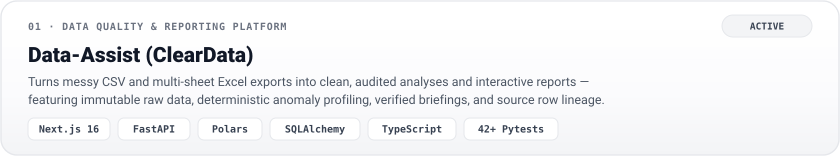
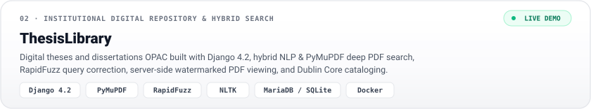
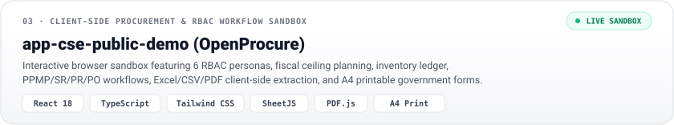
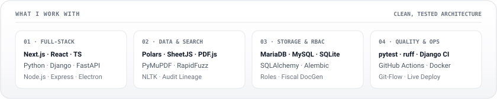

  

  &nbsp;
  &nbsp;
  &nbsp;
  

---

### 👋 About Me & What I Bring to the Table

I'm **John Mark Cayabyab**, a Computer Science graduate and full-stack software engineer based in **NCR, Philippines**, currently **open for hiring** (Full-Time, Contract, or Remote). I enjoy taking messy, manual workflows and turning them into calm, dependable web software.

<table>
  <tr>
    <td width="50%" valign="top">
      <h4>What I Bring</h4>
      <ul>
        <li><strong>End-to-End Delivery</strong> — I design schemas, write backend services, build REST APIs, and craft clean front-end interfaces across Python and TypeScript.</li>
        <li><strong>Live Office Production Experience</strong> — Deployed real-time queuing and fiscal procurement systems used daily at a government office (TESDA).</li>
        <li><strong>Data Integrity &amp; Search Focus</strong> — Comfortable with immutable audit trails, anomaly profiling, and hybrid PDF/text search workflows.</li>
        <li><strong>Steady, Independent Execution</strong> — Automated test suites, linting, Dockerized environments, and clear communication under minimal supervision.</li>
      </ul>
    </td>
    <td width="50%" valign="top">
      <h4>Hiring &amp; Role Fit</h4>
      <ul>
        <li><strong>Availability:</strong> Immediate — Full-Time, Internship-to-Hire, or Contract</li>
        <li><strong>Target Roles:</strong> Junior Software Engineer · Full-Stack Developer · Python / TypeScript Engineer · Data &amp; AI Systems Builder</li>
        <li><strong>Work Setup:</strong> Remote, Hybrid, or On-Site (NCR, Philippines)</li>
        <li><strong>Direct Contact:</strong> <a href="mailto:jcayabyab655@gmail.com">jcayabyab655@gmail.com</a></li>
      </ul>
    </td>
  </tr>
</table>

---

### 📦 Selected Repositories

  

  <a href="https://github.com/Tofuwho/Data-Assist"><strong>View Repository ↗</strong></a> &nbsp;·&nbsp; <code>Next.js 16</code> · <code>FastAPI</code> · <code>Polars</code> · <code>SQLAlchemy</code>

 

  

  <a href="https://tofuwho.github.io/ThesisLibrary/"><strong>Try Live OPAC Demo ↗</strong></a> &nbsp;·&nbsp; <a href="https://github.com/Tofuwho/ThesisLibrary"><strong>View Repository</strong></a> &nbsp;·&nbsp; <a href="https://codespaces.new/Tofuwho/ThesisLibrary"><strong>Open in Codespaces</strong></a>

 

  

  <a href="https://tofuwho.github.io/app-cse-public-demo/"><strong>Launch Live Sandbox ↗</strong></a> &nbsp;·&nbsp; <a href="https://github.com/Tofuwho/app-cse-public-demo"><strong>View Repository</strong></a>

  More builds and experiments live in <a href="https://github.com/Tofuwho?tab=repositories">all repositories</a> and <a href="./portfolio">the interactive portfolio app</a>.

---

### 🧰 Technical Stack

  

  

---

### 📋 Experience & Background

<table>
  <tr>
    <td width="50%" valign="top">
      <h4>🏢 OJT IT Engineer &amp; Full-Stack Developer</h4>
      
<strong>TESDA Muntiparlastapat District Office</strong> · <em>Feb 2026 – May 2026</em>

      <ul>
        <li>Built and deployed a real-time <strong>Queue Management System</strong> replacing manual paper queues in daily service operations.</li>
        <li>Developed a <strong>Procurement Ledger System</strong> automating compliant RIS, PR, PO, PPMP, and APP-CSE documents.</li>
        <li>Maintained live office hardware uptime and configured network printer subnet routing.</li>
      </ul>
    </td>
    <td width="50%" valign="top">
      <h4>🎓 B.S. Computer Science</h4>
      
<strong>Taguig City University</strong> · <em>June 2026</em>

      <ul>
        <li>Focused on full-stack web architectures, database design, applied search/NLP workflows, and reliable software testing.</li>
        <li>Built real-world systems spanning institutional archives, procurement workflows, and spreadsheet auditing platforms.</li>
      </ul>
    </td>
  </tr>
</table>

---

### 📈 Contribution Activity

  <picture>
    <source media="(prefers-color-scheme: dark)" srcset="https://raw.githubusercontent.com/Tofuwho/Tofuwho/output/github-snake-dark.svg" />
    <source media="(prefers-color-scheme: light)" srcset="https://raw.githubusercontent.com/Tofuwho/Tofuwho/output/github-snake.svg" />
    
  </picture>

---

  <strong>Open for Hiring</strong> — Looking for a dependable Junior Software Engineer or Full-Stack Developer? Feel free to <a href="mailto:jcayabyab655@gmail.com">email me</a> or try any live demo above.

